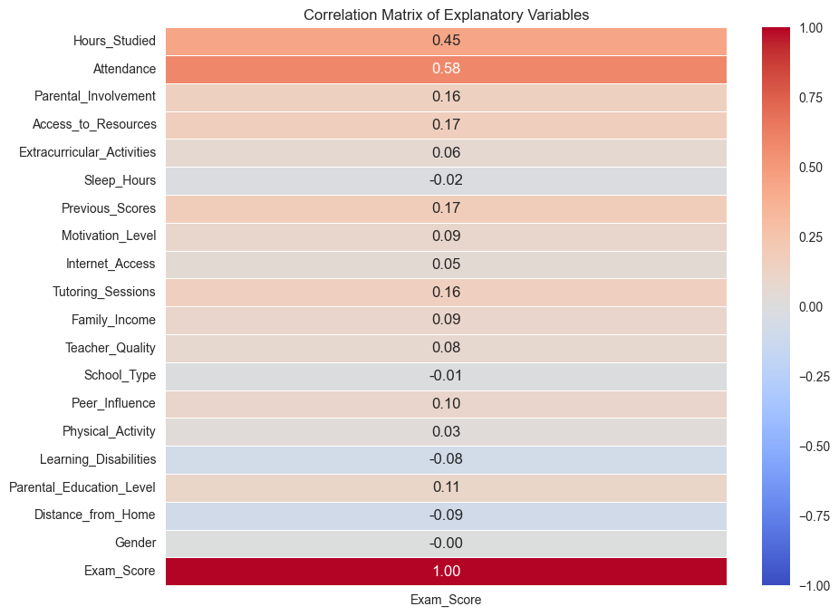
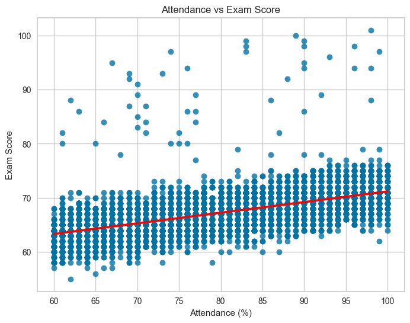
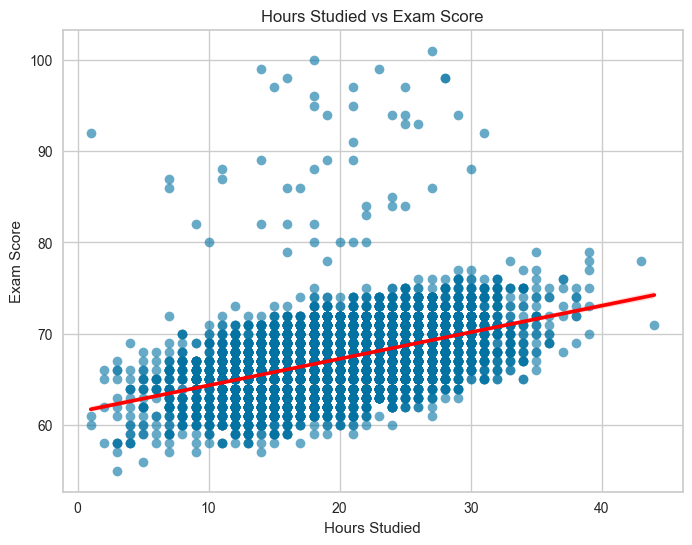
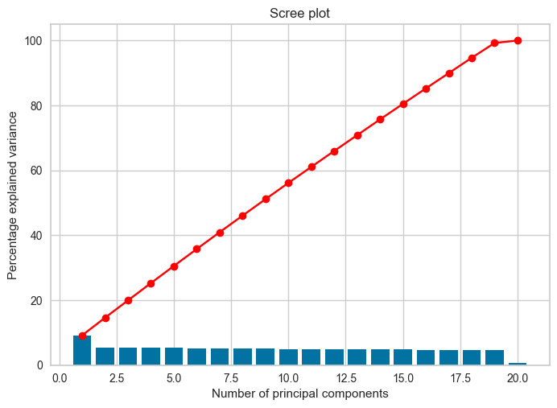

<div align="center">

# Student Performance Prediction

### An end-to-end classical machine learning study: preprocessing, EDA, PCA, regression and classification


</div>

---

## Overview

Collaborative project for the **Statistical Foundations for Cybersecurity** course
(Part 2), completed in **December 2024**. It is an early, foundational project: it
documents where my machine learning fundamentals started, and it is kept as written
rather than modernised.

We ask a simple question on a real-world tabular dataset: **which factors
predict a student's exam score, and how well can we predict it?**

The notebook walks through the full supervised-learning workflow and justifies each
decision in writing, including the ones that did not help (mean imputation, PCA).

| | |
|---|---|
| **Data** | [Student Performance Factors](https://www.kaggle.com/datasets/lainguyn123/student-performance-factors) (Kaggle), 6,607 records, 19 features, target `Exam_Score`, included in `archive/` |
| **Date** | December 2024 (course submission deadline: 20 December 2024) |
| **Tasks** | Regression (exact score) and 3-class classification (Low / Medium / High) |
| **Stack** | Python, pandas, NumPy, scikit-learn, SciPy, seaborn, Matplotlib |
| **Authors** | Tanguy Stekke and Emmanuel Atwam |

## Assignment brief

The project follows a course brief ([ProjectGuidelines.pdf](ProjectGuidelines.pdf)): a
pair project in Jupyter covering the full ML workflow, a notebook documented with
Markdown rationale, and a 10 to 15 slide presentation
([docs/ML_Presentation_Stekke_Emmanuel.pptx](docs/ML_Presentation_Stekke_Emmanuel.pptx)).
How each requirement was addressed:

| Brief requirement | What we did | Status |
|---|---|---|
| Data selection, usage rights, no private data | Public Kaggle dataset of student records with no personal identifiers | Done |
| Preprocessing: missing values, duplicates, outliers | Missing values dropped (3.5% of rows), duplicates checked (none found), encoding and scaling applied. Distributions were viewed in the EDA plots, but **no outlier detection or removal was applied** | Partial |
| Exploratory data analysis | Correlation heatmap, regression, box and violin plots, written conclusions | Done |
| At least two diverse algorithms, justified | Linear Regression and Random Forest Regressor, plus a Random Forest Classifier, chosen from the EDA and PCA findings | Done |
| 80/20 split and cross-validation for tuning | 80/20 split with a fixed seed. 5-fold `GridSearchCV` on the Random Forest regressor (see limitations) | Done |
| Evaluation with appropriate metrics, discussion | R², MSE, RMSE for regression. Precision, recall, F1, accuracy and confusion matrix for classification | Done |
| Documentation in the notebook | Markdown rationale for each step | Done |
| Presentation | Included in `docs/` | Done |

## Method

```
Raw data ─► Cleaning ─► Encoding ─► EDA ─► Scaling ─► PCA check ─► Feature selection ─► Models ─► Evaluation
```

1. **Cleaning.** 229 rows (3.5%) had missing values and were dropped, leaving 6,378
   rows. The notebook records that mean imputation was tried first and gave worse
   model results, but that comparison is described in text and its code is not kept.
   A duplicate check found no duplicate rows.
2. **Encoding.** Label encoding for binary variables, ordinal encoding for ordered
   ones (for example Low < Medium < High), chosen to preserve ranking information.
3. **Exploratory analysis.** Correlations, regression plots, box and violin plots.
4. **Dimensionality reduction.** PCA was run and **rejected**: features are weakly
   correlated with each other, so there is little redundancy to compress.
5. **Feature selection.** Five weak features dropped (`Sleep_Hours`, `School_Type`,
   `Internet_Access`, `Gender`, `Physical_Activity`).
6. **Modelling.** 80/20 train-test split with a fixed seed, cross-validated grid search
   for the Random Forest regressor.

## Results

### Regression (predict the exact score)

| Model | R² | RMSE | MSE |
|---|---|---|---|
| **Linear Regression** | **0.727** | **2.06** | **4.24** |
| Random Forest Regressor | 0.654 | 2.32 | 5.37 |

The simpler linear model won. That fits what the EDA showed: the signal is mostly
linear and carried by a few features, so a more flexible model has little extra to
learn here (a plausible explanation, not something we tested).

### Classification (Low / Medium / High)

Categories come from the score distribution (below the 25th percentile, between the
25th and 75th, above the 75th).

| Class | Precision | Recall | F1 |
|---|---|---|---|
| High | 0.90 | 0.80 | 0.85 |
| Medium | 0.74 | 0.88 | 0.80 |
| Low | 0.88 | 0.72 | 0.79 |
| **Overall accuracy** | | | **0.814** |

Most errors are between **adjacent** classes (see the confusion matrix in the
notebook), which is expected when classes are cut from a continuous score.

### What drives exam scores

<p align="center">
  
  
</p>

Attendance (r = 0.58) and hours studied (r = 0.45) are the strongest predictors. Every
other feature is below 0.20.

<p align="center">
  
  
</p>

## Team and contributions

Pair project by **Tanguy Stekke** and **Emmanuel Atwam**. We worked on every part
together, from choosing the dataset to the final presentation, so there is no split of
ownership to report. The work covered:

- **Data preparation:** missing-value handling, duplicate checks, label and ordinal encoding, scaling
- **Exploration:** correlation analysis, visualisation and a PCA check
- **Modelling:** Linear Regression, Random Forest Regressor and Random Forest Classifier, with cross-validated tuning
- **Evaluation:** R², MSE and RMSE for regression, precision, recall, F1 and a confusion matrix for classification
- **Communication:** the written rationale in the notebook and the 14-slide presentation

## Repository layout

```
.
├── ML_Project_Stekke_Emmanuel.ipynb   # full analysis, with commentary
├── myfunctions.py                     # PCA / clustering plotting helpers
├── ProjectGuidelines.pdf              # the course brief this work answers
├── archive/                           # dataset (see archive/README.md)
├── docs/
│   ├── ML_Presentation_Stekke_Emmanuel.pptx
│   └── figures/                       # plots used in this README
└── requirements.txt
```

## Run it

```bash
git clone <this-repo-url> && cd <this-repo>
python -m venv .venv && source .venv/bin/activate
pip install -r requirements.txt
jupyter lab ML_Project_Stekke_Emmanuel.ipynb
```

Tested on Python 3.12 with pandas 2.3, scikit-learn 1.9 and NumPy 2.5. Re-running the
notebook end to end reproduces the metrics reported above exactly. The notebook was
written against an earlier pandas and does not run on pandas 3, which is why
`requirements.txt` pins `pandas<3`.

## Scope and limitations

Stated plainly, because they matter more than the headline numbers:

- **Outliers were not removed.** The brief asks for outlier handling. We inspected
  distributions but did not apply a removal or capping step.
- **Classical ML only.** This project uses linear and tree-based models. It does not
  cover neural networks, deep learning frameworks or NLP.
- **Tuning was light.** The grid search shown contains a single configuration, the
  best one found earlier in a larger search that is not kept in the notebook.
- **Some choices were made on the full dataset.** Feature selection from EDA and the
  class thresholds (percentiles) were computed before the train-test split. This is a
  mild form of leakage; a stricter pipeline would fit them on the training set only.
- **Single split.** Reported metrics come from one 80/20 split, without confidence
  intervals.
- **The data is a public Kaggle benchmark** of unclear provenance, so conclusions about
  real students should not be drawn from it.

## Where I would take it now

This project is archived as a 2024 snapshot. If I revisited it, I would:

- Wrap preprocessing and models in a single scikit-learn `Pipeline` to remove the leakage above
- Repeated cross-validation with confidence intervals
- Gradient boosting and a small PyTorch MLP as additional baselines
- SHAP-based feature attribution

## License

Copyright 2024 Tanguy Stekke and Emmanuel Atwam. **All rights reserved.** This is a
learning project from a machine learning course, published for viewing only. Please do
not copy it, reuse it or submit it as your own work. See [LICENSE](LICENSE). The dataset
and the course brief belong to their original authors and are not covered by this notice.

## Acknowledgements

Dataset by [lainguyn123 on Kaggle](https://www.kaggle.com/datasets/lainguyn123/student-performance-factors).
Course: Statistical Foundations for Cybersecurity, brief by F. Saïd.
